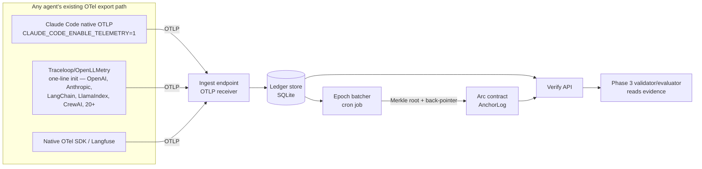
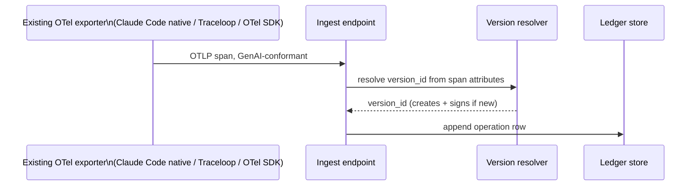
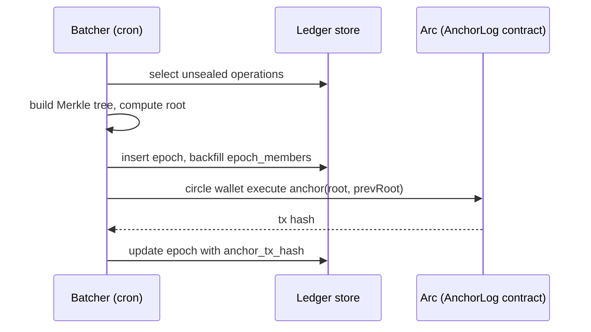
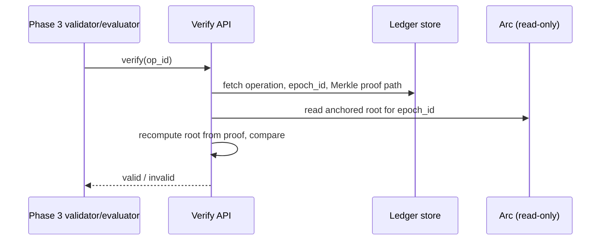

# Phase 2 Architecture — Evidence & Instrumentation Layer

Status: design, not yet built. Precedes Phase 3 (trust & verification), which
consumes what this phase produces. See `docs/IDEA.md` §5 for how this fits
the overall roadmap, and §4 for the standards this must interoperate with
(OpenTelemetry GenAI semconv, ERC-8004).

## 1. Purpose

Give an agent a way to produce a versioned, tamper-evident record of its
own operations, cheaply enough to run on every call and privately enough
that a builder doesn't have to route sensitive content through us to get
one. Phase 3's Tier 0 evidence checks assume this exists; right now it
doesn't, for anyone.

## 2. System context



**One ingestion path, from day one — not a Claude-Code-specific one plus a
"real" one added later.** An earlier version of this design had a Skill
hook writing directly to local storage as the Milestone 2.0 mechanism,
with a general OTLP endpoint deferred to Milestone 2.1. That was wrong,
for the same reason it would have been wrong for OpenTelemetry itself to
ship a Flask-specific ingestion mode before a generic one: it builds the
special case first and the standard interface second, which is backwards
if the goal is >90% of agents being able to "flip it on."

**The corrected model, checked against what already exists rather than
assumed:** Claude Code already speaks OTLP natively — set
`CLAUDE_CODE_ENABLE_TELEMETRY=1` and `OTEL_EXPORTER_OTLP_ENDPOINT`, no
code. Traceloop's OpenLLMetry already auto-instruments 20+ LLM providers
and the major agent frameworks with one init call. Between those two and
plain OTel/Langfuse for everything else, the large majority of agents
that could adopt this already have a zero-or-near-zero-code path to
OTLP — provided the thing on the other end is a correct, generic OTLP
receiver. That receiver is the one thing worth building. Custom
per-framework code is the exception now, reserved for genuine gaps
nothing upstream already covers (§3, §8).

## 3. Components

| Component | Responsibility | Milestone |
|---|---|---|
| **Ingest endpoint** | Generic OTLP-over-HTTP receiver. Accepts any spec-compliant GenAI trace, regardless of what produced it — Claude Code's native exporter, Traceloop, Langfuse, raw OTel SDK | 2.0 |
| **Ledger store** | Append-only record of operations, versions, and epochs. SQLite for now — same choice as Phase 1, see design-decisions ADR-002 | 2.0 |
| **Version resolver** | Derives a stable `version_id` from whatever version-identifying attributes are present on an incoming span (model id always present per GenAI semconv; code/prompt hash where the source provides one, else falls back to a coarser identity — see §8) | 2.0 |
| **Attestation signer** | Signs each new version's manifest using the agent's own Circle Agent Wallet key (`circle wallet sign`) — no new key management | 2.0 |
| **Epoch batcher** | Cron job: every N operations or T minutes, builds a Merkle tree over unsealed operations, seals an epoch | 2.0 |
| **Anchor writer** | Commits `(merkle_root, prev_epoch_root)` to a minimal Arc contract via `circle wallet execute` | 2.0 |
| **Verify API** | Given an operation + Merkle proof, confirms inclusion in a specific anchored epoch without trusting the ledger DB | 2.0 (local function), 2.1 (as a service) |
| **Config-snippet docs** | Copy-paste setup for the top ingestion paths — Claude Code env vars, Traceloop one-liner, raw OTel SDK config — not code we write, documentation we own | 2.1 |
| **Gap-fill instrumentation** | Only where no existing exporter covers a real target agent stack. Contributed upstream to the relevant open-source project (e.g. OpenLLMetry) rather than kept as a proprietary plugin — see ADR-006 | 2.2, exception not default |

## 4. Data model

Four tables, extending the same SQLite approach `poll_spend.py` already
uses — no new database technology introduced in Phase 2.

```sql
CREATE TABLE agent_versions (
    version_id      TEXT PRIMARY KEY,   -- hash(code_ref, prompt_hash, model_id)
    agent_identity  TEXT,               -- ERC-8004 agentId once registered, else a local placeholder
    code_ref        TEXT,               -- git commit / package version
    prompt_hash     TEXT,
    model_id        TEXT,
    signature       TEXT,               -- circle wallet sign() over the above, hex
    created_at      TEXT NOT NULL
);

CREATE TABLE operations (
    op_id           TEXT PRIMARY KEY,   -- otel span_id
    trace_id        TEXT NOT NULL,
    version_id      TEXT NOT NULL REFERENCES agent_versions(version_id),
    operation_type  TEXT NOT NULL,      -- invoke_agent | chat | execute_tool, per OTel GenAI semconv
    input_hash      TEXT NOT NULL,
    output_hash     TEXT NOT NULL,
    content_ref     TEXT,               -- pointer to off-chain content blob, NULL if redacted/excluded
    token_usage     TEXT,               -- JSON, per gen_ai.usage.* attributes
    started_at      TEXT NOT NULL,
    ended_at        TEXT,
    epoch_id        TEXT REFERENCES epochs(epoch_id)   -- NULL until batched
);

CREATE TABLE epochs (
    epoch_id        TEXT PRIMARY KEY,
    prev_epoch_id   TEXT REFERENCES epochs(epoch_id),
    merkle_root     TEXT NOT NULL,
    op_count        INTEGER NOT NULL,
    sealed_at       TEXT NOT NULL,
    anchor_tx_hash  TEXT,               -- NULL until the anchor write confirms
    anchored_at     TEXT
);

CREATE TABLE epoch_members (
    epoch_id        TEXT NOT NULL REFERENCES epochs(epoch_id),
    op_id           TEXT NOT NULL REFERENCES operations(op_id),
    leaf_index      INTEGER NOT NULL,
    leaf_hash       TEXT NOT NULL,   -- frozen at sealing time, see below
    PRIMARY KEY (epoch_id, op_id)
);
```

`leaf_hash` was added after the initial design — not in the original
plan. Building `verify()` against the design above surfaced a real gap:
rebuilding the tree from live `operations` data on every check meant one
tampered operation changed the recomputed root for its *entire* epoch,
correctly detecting corruption but unable to isolate which operation
caused it, or still vouch for its untouched siblings. Freezing each
leaf's hash at sealing time and rebuilding from those frozen hashes
instead of live data fixes this — see `docs/SETUP.md`'s Milestone 2.0
build log for the before/after test that found and confirmed it.

`content_ref` being nullable is deliberate: a builder can emit a fully
valid, verifiable record — hashes, version binding, epoch membership — 
without ever sending us the actual prompt/response content. See ADR-007.

## 5. Key flows

**5a. Normal operation (Milestone 2.0, our own agent — via whichever
existing OTel export path fits its runtime, not a custom hook)**



**5b. Epoch sealing and anchoring (cron, same pattern as `poll_spend.py`)**



**5c. Verification (consumed by Phase 3)**



## 6. Non-functional requirements

- **Throughput**: sized for our own dogfooding first (low single digits of
  ops/sec). Not designed for x402's "dozens of calls per second per agent"
  scale until Milestone 2.1 — batching cadence (ADR-008) is the lever, not
  a rewrite.
- **Retention**: no external mandate applies yet (EU AI Act Article 12
  isn't in force for high-risk systems until 2027-12-02/2028-08-02 per
  `docs/IDEA.md` §5) — retain indefinitely by default in the MVP, revisit
  once a real compliance target exists.
- **Privacy**: content is off-chain, redactable per-field, never required
  for a record to be valid (§4). Only hashes and the Merkle root reach
  the chain.
- **Security / threat model, briefly**: the ledger DB is a single point of
  trust for anything *not yet anchored* — an operator could rewrite
  unsealed rows before an epoch seals. Sealing cadence is a direct lever
  on this exposure window (ADR-008). Once anchored, tampering with a
  sealed row is detectable, not prevented — Verify API turns "prevented"
  into "detected," which is the honest claim to make. Detection is
  per-operation, not per-epoch: `epoch_members.leaf_hash` freezes each
  operation's hash at sealing time, so tampering with one operation is
  caught precisely, without falsely implicating its untouched siblings —
  confirmed by the Milestone 2.0 build's own tamper test, see
  `docs/SETUP.md`.

## 7. Interfaces

- **OTLP HTTP receiver, from Milestone 2.0** — standard OpenTelemetry
  Protocol, no custom wire format. Any existing exporter (Claude Code's
  native telemetry, Traceloop, Langfuse, raw OTel SDK) works against it
  unmodified. This is the primary, and for most builders the *only*,
  interface — there is deliberately no separate proprietary SDK call for
  the common case.
- `verify(op_id) -> bool` — the function Phase 3 actually depends on.
- `record_operation(...)` still exists as a direct-call fallback for the
  rare source that can't emit OTLP at all, but it is not the documented
  primary path and shouldn't be presented as one — see ADR-006.

## 8. Open technical risks

- **Version resolution is not uniformly solvable from OTLP alone.** OTel
  GenAI semconv guarantees a model identifier (`gen_ai.request.model`) on
  every span, but not a code-version or prompt-version attribute — those
  aren't part of the standard. Where a source doesn't provide one, the
  resolver falls back to a coarser identity (model id + first-seen
  timestamp of a given input-schema shape), which is weaker evidence than
  a true code/prompt hash. This needs a real design pass, not an
  assumption: possibly a documented custom span attribute
  (`arc.version_id`) that sources can optionally set for stronger
  evidence, falling back gracefully when they don't.
- Merkle proof storage grows with `epoch_members` — fine at dogfooding
  scale, needs a pruning/archival plan before real external volume.
- `circle wallet execute` for the anchor write needs a deployed
  `AnchorLog` contract on Arc — not yet written; a five-function Solidity
  contract (`anchor(root, prevRoot)`, a getter, an event) is the expected
  shape, not yet drafted.
- Gap-fill instrumentation (Milestone 2.2) has no target list yet — needs
  an actual audit of which real, high-value agent stacks have *no*
  existing OTel export path today, rather than assuming frameworks in
  general need custom adapters.
