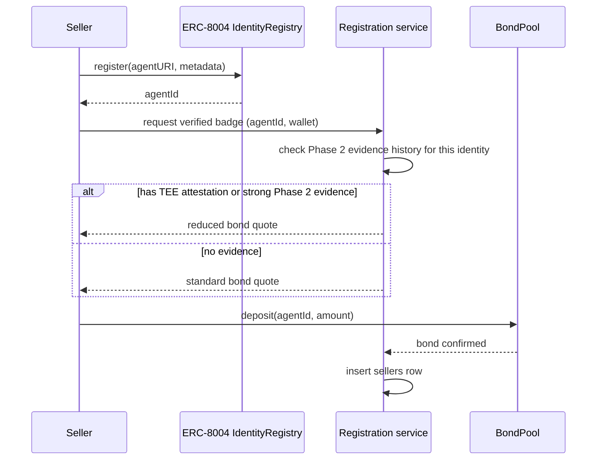
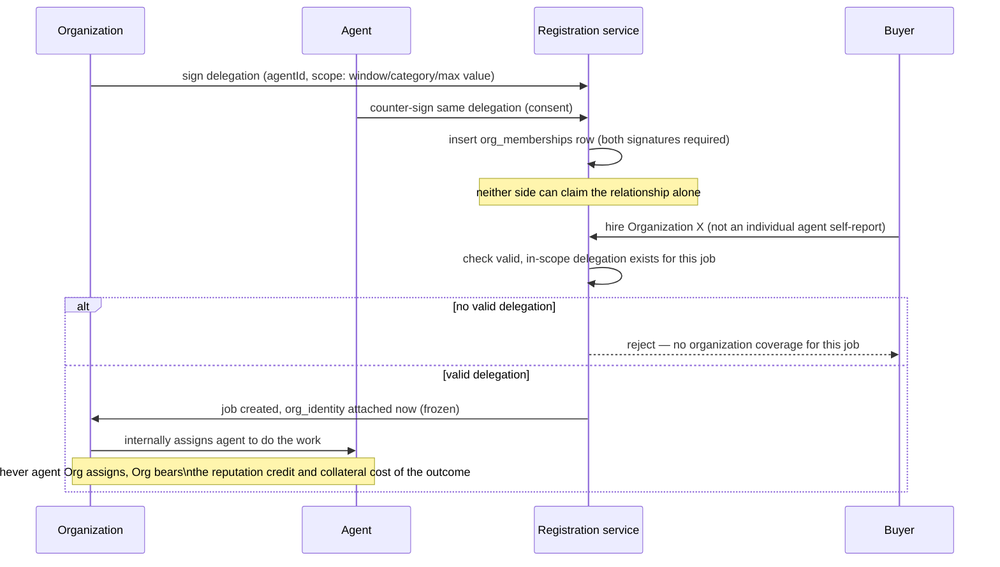
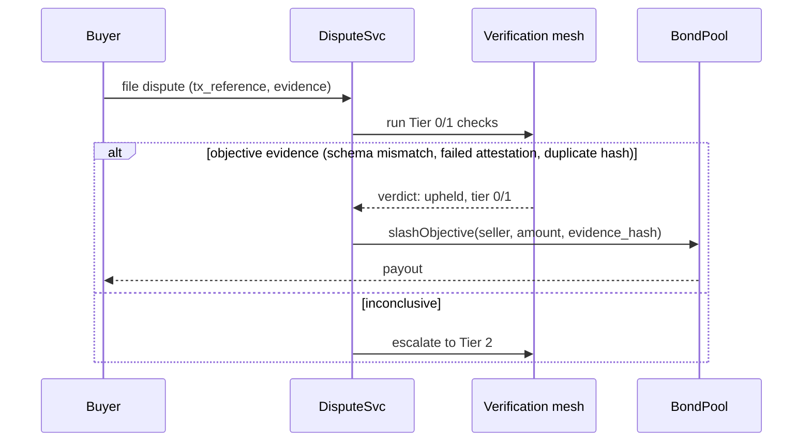
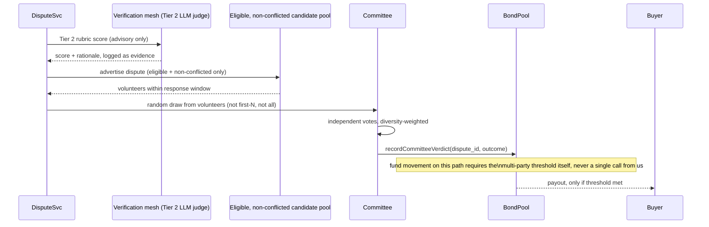
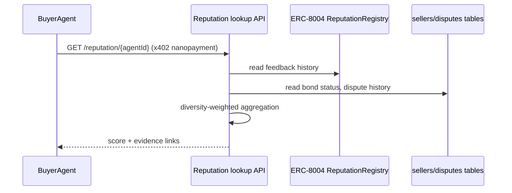

# Phase 3 Architecture — Trust & Verification Layer

Status: design, not yet built. Depends on Phase 2's evidence ledger
(`docs/phase2-architecture.md`) for its Tier 0 evidence input. See
`docs/IDEA.md` §4-§5 for the standards landscape and roadmap this
implements, and `docs/phase3-design-decisions.md` ADR-001 for the
objective/discretionary split this architecture is built around.

Standards check refreshed 2026-09-19 (fetched eips.ethereum.org
directly, not from memory) immediately before writing this, per
`docs/IDEA.md` §9's own instruction that this cluster moves and needed a
fresh read before implementation planning. Both ERC-8004 and ERC-8183
remain Draft status, unchanged in shape from the earlier research pass.
One thing worth stating plainly because it's now confirmed in the
standard's own text, not inferred: ERC-8183 says outright that *"a
malicious evaluator can complete or reject arbitrarily"* and that there
is *"no dispute resolution or arbitration; reject/expire is final."*
That is exactly the gap this phase exists to fill — the standard names
its own missing piece.

## 1. Purpose

Give buyers and sellers on Arc a way to know, before and after a
transaction, whether a counterparty is trustworthy — combining objective
evidence (Phase 2's ledger, TEE attestations), a standards-based identity
and feedback layer (ERC-8004), and a bond that makes bad behavior costly,
without us becoming an unlicensed insurer or money transmitter (ADR-001).

## 2. System context

```mermaid
flowchart LR
    subgraph OnChain["Arc — existing standards, not ours"]
        IDR[ERC-8004\nIdentityRegistry]
        RepR[ERC-8004\nReputationRegistry]
        ValR[ERC-8004\nValidationRegistry]
        Job[ERC-8183\nJob escrow contracts\n(any deployer's)]
        AnchorLog[Phase 2\nAnchorLog]
    end

    subgraph Ours["What we operate"]
        Bond[BondPool contract]
        Mesh[Verification mesh\nTier 0-3]
        DisputeSvc[Dispute service\noff-chain orchestration]
    end

    Seller -->|registers| IDR
    Seller -->|emits evidence| AnchorLog
    Buyer -->|pays via x402| Seller
    Buyer -->|files dispute, submits evidence| DisputeSvc
    DisputeSvc --> Mesh
    Mesh -->|Tier 0/1: objective| Bond
    Mesh -->|Tier 2/3: discretionary| Committee[Multi-party committee vote]
    Committee -->|non-binding recommendation| Bond
    Bond -->|slash / release| Seller
    Bond -->|payout| Buyer
    Ours -->|acts as validator| ValR
    Ours -->|acts as evaluator, when named| Job
    RepR -->|read for reputation lookups| BuyerLookup[Buyer reputation query]
```

Two on-chain systems we don't own (ERC-8004's registries, and any given
ERC-8183 Job contract) plus one we do (`BondPool`) plus one off-chain
orchestration service (`DisputeSvc`, which runs the tiered mesh and
routes discretionary cases to a committee). This mirrors Phase 2's own
"generic receiver, not a proprietary system" posture (ADR-006) — here
applied to identity and escrow standards instead of telemetry.

## 3. Components

| Component | Responsibility | Depends on |
|---|---|---|
| **Registration service** | Registers our own agent (and, later, verified sellers on request) in ERC-8004's `IdentityRegistry` | ERC-8004 (external) |
| **Validator role** | Calls `giveFeedback()` on `ReputationRegistry` using Phase 2 evidence + verification-mesh verdicts as the basis; responds to `validationRequest()` as an ERC-8004 validator | ERC-8004, Phase 2 ledger |
| **Evaluator role** | Where named as the `evaluator` on an ERC-8183 Job, calls `complete()`/`reject()` based on verification-mesh output rather than unaccountable discretion — this is the direct answer to the EIP's own stated gap | ERC-8183 (external), verification mesh |
| **Verification mesh** | The 4-tier evidence pipeline (see `docs/IDEA.md` §5) — Tier 0/1 automated checks, Tier 2 LLM judge (advisory only), Tier 3 committee escalation | Phase 2 ledger, TEE attestation providers, LLM API |
| **BondPool contract** | Holds seller bonds. Exposes two separate paths per ADR-001: an automatic `slashObjective()` callable only with Tier 0/1 evidence, and a `recordCommitteeVerdict()` path that only *records* a discretionary outcome — actual fund movement on that path requires a separate multi-signature/committee-threshold call, never a single-party decision | ADR-001 |
| **Committee mechanism** | Multi-party vote for Tier 2/3 disputes, incentivized from the disputed bond itself (UMA's model, not our treasury) — see ADR-002 below | BondPool |
| **Reputation lookup API** | The paid product surface: `GET /reputation/{agent_identity}` combining ERC-8004 feedback history + our own bond/dispute record | ERC-8004 (read), BondPool (read) |
| **Diversity-weighted aggregation** | Reputation scores are never a naive attestation count — inverse-Simpson-style weighting by distinct attester identity, per the ERC-8275 Sybil lesson already recorded in `docs/IDEA.md` §4 | ERC-8004 feedback data |

## 4. Data model additions

Extends Phase 2's SQLite ledger with tables specific to trust/dispute
state. Kept in the same database technology for the same reason ADR-002
(Phase 2) gave: no concurrent-multi-writer requirement yet, no reason to
introduce a second stack before one exists.

```sql
CREATE TABLE sellers (
    agent_identity      TEXT PRIMARY KEY,   -- ERC-8004 agentId
    wallet_address      TEXT NOT NULL,
    bond_amount         TEXT NOT NULL,      -- currently LOCKED collateral in BondPool, USDC as string —
                                             -- ADR-013 Part C: this is what a slash actually draws from,
                                             -- not an abstract number. Zero means not hedge-eligible.
    bond_source         TEXT NOT NULL,      -- 'deposit' | 'levy_accumulation' — the two paths in ADR-013 Part C
    bond_tx_hash        TEXT,
    tee_attested        INTEGER NOT NULL DEFAULT 0,  -- lower bond required if true
    registered_at       TEXT NOT NULL
);
-- Max hedgeable job value for this seller = bond_amount (ADR-013 Part C) —
-- enforced at hedge-purchase time (backlog H4), not just at slash time.

CREATE TABLE disputes (
    dispute_id          TEXT PRIMARY KEY,
    seller_identity     TEXT NOT NULL REFERENCES sellers(agent_identity),
    buyer_wallet         TEXT NOT NULL,
    tx_reference         TEXT NOT NULL,      -- the x402/ERC-8183 payment being disputed
    evidence_ref          TEXT,               -- buyer-submitted evidence, opt-in per Phase 2 ADR-007's redaction principle
    tier_reached         TEXT NOT NULL,      -- '0' | '1' | '2' | '3'
    verdict               TEXT,               -- 'upheld' | 'rejected' | 'pending'
    payout_tx_hash        TEXT,
    filed_at             TEXT NOT NULL,
    resolved_at           TEXT
);

CREATE TABLE committee_votes (
    dispute_id           TEXT NOT NULL REFERENCES disputes(dispute_id),
    voter_identity        TEXT NOT NULL,      -- distinct identity, feeds diversity weighting
    vote                  TEXT NOT NULL,      -- 'uphold' | 'reject'
    voted_at              TEXT NOT NULL,
    PRIMARY KEY (dispute_id, voter_identity)
);

-- ADR-015: organizations as a collateral-holding layer above individual
-- agents. Same shape as `sellers` deliberately — an organization posts
-- collateral and gets hedge-eligibility the identical way an individual
-- seller does (ADR-013 Part C); it's a first-class identity, not a
-- payment address.
CREATE TABLE organizations (
    org_identity        TEXT PRIMARY KEY,   -- ERC-8004 agentId, if ADR-015's open question
                                             -- resolves to reusing IdentityRegistry
    wallet_address       TEXT NOT NULL,
    bond_amount          TEXT NOT NULL,      -- locked collateral in BondPool, USDC as string
    bond_source           TEXT NOT NULL,      -- 'deposit' | 'levy_accumulation', same two paths as sellers
    bond_tx_hash          TEXT,
    registered_at         TEXT NOT NULL
);

-- The mutual-consent delegation record itself (ADR-015 Decision #2/#3).
-- Both signatures are required for a row to be valid — neither side can
-- claim the relationship unilaterally. Scoped, not blanket: a standing
-- grant with real limits, not a per-job re-signature.
CREATE TABLE org_memberships (
    org_identity          TEXT NOT NULL REFERENCES organizations(org_identity),
    agent_identity        TEXT NOT NULL,      -- ERC-8004 agentId of the member agent
    org_signature         TEXT NOT NULL,      -- org's controlling key: "I authorize this agent"
    agent_signature        TEXT NOT NULL,      -- agent's key: "I consent to act under this org's collateral"
    scope_start            TEXT NOT NULL,
    scope_end              TEXT,               -- NULL = no expiry set; still revocable, see revoked_at
    scope_category         TEXT,               -- optional, e.g. Marketplace category limits
    scope_max_job_value    TEXT,               -- optional amount ceiling, USDC as string
    revoked_at             TEXT,
    created_at             TEXT NOT NULL,
    PRIMARY KEY (org_identity, agent_identity, scope_start)
);
```

`disputes` gains one nullable column, `org_identity TEXT REFERENCES
organizations(org_identity)` — set once, at the same time the row is
created, from the job's own hiring-time attribution (ADR-015 Decision
#4: the buyer hired the organization directly, so this is read back
from that record, never a separately-collected claim). NULL means the
agent was hired and is acting under its own individual collateral, the
same as before this ADR existed.

Organization-level reputation (ADR-015's second score) is deliberately
**not** a new persisted table — it's computed the same way agent
reputation already is (ADR-004's diversity-weighted aggregation),
just run over the set of `disputes`/completed jobs carrying a given
`org_identity` instead of a given seller's own history. Reusing the
existing aggregation code path, not inventing a second one.

## 5. Key flows

**5a. Seller onboarding**



**5a-org. Organization delegation and org-hiring (ADR-015)**



**5b. Objective-path dispute (Tier 0/1 — automatic, per ADR-001)**



**5c. Discretionary-path dispute (Tier 2/3 — advertise-and-volunteer
committee assembly, per ADR-001/ADR-011)**



**5d. Reputation lookup (the paid product surface)**



## 6. Non-functional requirements

- **Never a single-party discretionary payout.** This is the load-bearing
  constraint from ADR-001 — enforced structurally (a separate contract
  path requiring a committee threshold), not by policy alone, since a
  policy is exactly what a regulator would look past.
- **Bond custody stays on Arc**, consistent with Phase 2 ADR-004's
  reasoning — one chain, one coherent trust stack (identity, bond,
  evidence anchor all in one place).
- **Reputation aggregation must never be a naive attestation count** —
  the ERC-8275 Sybil lesson is a hard requirement, not a nice-to-have,
  checked at implementation time against real code, not assumed correct
  because it's documented.
- **Retry/idempotency on-chain writes** follow the same pattern Phase 2's
  D2 established (`anchor_pending_epochs`) — don't invent a second retry
  philosophy for bond/dispute writes.

## 7. Interfaces

- `register_seller(agent_identity, wallet_address, tee_attested: bool) -> bond_quote`
- `file_dispute(seller_identity, buyer_wallet, tx_reference, evidence_ref=None) -> dispute_id`
- `GET /reputation/{agent_identity}` — the x402-payable product endpoint (Phase 4 distribution mechanics apply here directly)
- `BondPool.slashObjective(...)` / `BondPool.recordCommitteeVerdict(...)` — the two structurally separate contract entry points from ADR-001

## 8. Open technical risks

- **The full trust mechanism (ADR-006 through ADR-014 in
  `docs/phase3-design-decisions.md`) is now fully designed but entirely
  unbuilt** — who's eligible (tenure/genuine-activity/topic-relevance,
  pool-relative and dispute-value-scaled thresholds), how selection and
  vote weight resist collusion (participation-frequency,
  above-baseline-agreement, and graph-level clustering across both the
  voting and economic-activity graphs), how new arbiters bootstrap trust
  before real dispute volume exists (an evergreen calibration track), how
  a volunteer shortfall is resolved (the four-tier escalation ladder),
  and — the piece completed most recently — how the money itself moves
  safely (no custody on either side, payouts structurally incapable of
  rewarding self-dealing, seller collateral that must be locked before
  coverage exists, actuarial pricing for both premiums and slashes).
  Decided explicitly (per the user, 2026-09-19) as the project's primary
  market defensibility, on the reasoning that the mechanism's code is
  necessarily auditable (Epic F1) and therefore copyable, but the
  accumulated calibration/tenure/collusion-clean/locked-collateral track
  record of real participants who've already been through it is not.
  This raises, not lowers, the execution-risk stakes: it is a genuinely
  elaborate system to get right on the first try, and for a business
  whose product is "trust our judgment," a bug in it is a worse failure
  than being simple and slow. See `docs/phase3-backlog.md` for the
  staged build sequence — Epic G's locked-collateral core (G1–G4) now
  sits right after Epic A, since Epic C's automatic slashing depends on
  it exactly as much as Epic D's discretionary payouts do, a dependency
  an earlier pass through this design missed; Epic G's remaining stories
  (the buyer-purchased premium and its pricing) gate Epic D specifically.
  Epic D's own internal sequence (D.1 raw signals → D.2
  eligibility/selection → D.3 collusion detection → D.4
  hardening/validation) respects the real dependencies between these
  ADRs rather than building
  them in the order they were designed.
- **`BondPool`'s exact contract shape is designed in detail (ADR-013/014)
  but the actual Solidity isn't written.** The two-path payout split
  (ADR-001), the per-seller locked-collateral ledger (ADR-013 Part C),
  and the pricing formulas (ADR-014) are all specified; none is coded
  yet. Should follow the same "estimate before committing" discipline
  the `AnchorLog` build established in Phase 2.
- **TEE attestation verification is a "buy, don't build" dependency**
  (per `docs/IDEA.md` §5) — no provider (Phala/Marlin/Atoma) has been
  evaluated yet for actual integration cost or attestation format.
- **Real legal counsel review of ADR-001 and, specifically, ADR-013's
  concrete implementation is still outstanding** — flagged in
  `docs/IDEA.md` §8-9 as needed bundled into design-partner outreach,
  not after building. This architecture assumes both hold; if legal
  review finds otherwise, the `BondPool` contract shape in this document
  would need to change, not just its parameters. This is the single
  highest-leverage open item in the whole Phase 3 design — everything
  else here can be corrected in code; this one needs a professional
  opinion no amount of further design work substitutes for.
